# AirIQ: Real-Time Air Quality Intelligence

Built for the **BREATHE BETTER** hackathon. AirIQ shows live air quality for any place on Earth: a real-time AQI dashboard, an interactive pollution map with heatmaps, history, forecasts, health advice, smart alerts and an AI assistant. It uses public data only (Open-Meteo / Copernicus CAMS, plus optional WAQI or OpenAQ ground stations), works with **no API keys**, and labels where every number comes from. Where ground stations exist, the headline is **station-first** (median of fresh stations within 15 km), and it offers three scales: **US AQI, European AQI and India NAQI** (computed by AirIQ per CPCB).

> General information, not medical advice. See [/about](app/about/page.tsx) in the app for sources, licences, methods and limitations.

## Screenshots

All taken from the production build with live data on 11 Nov 2026.

| | |
| --- | --- |
| 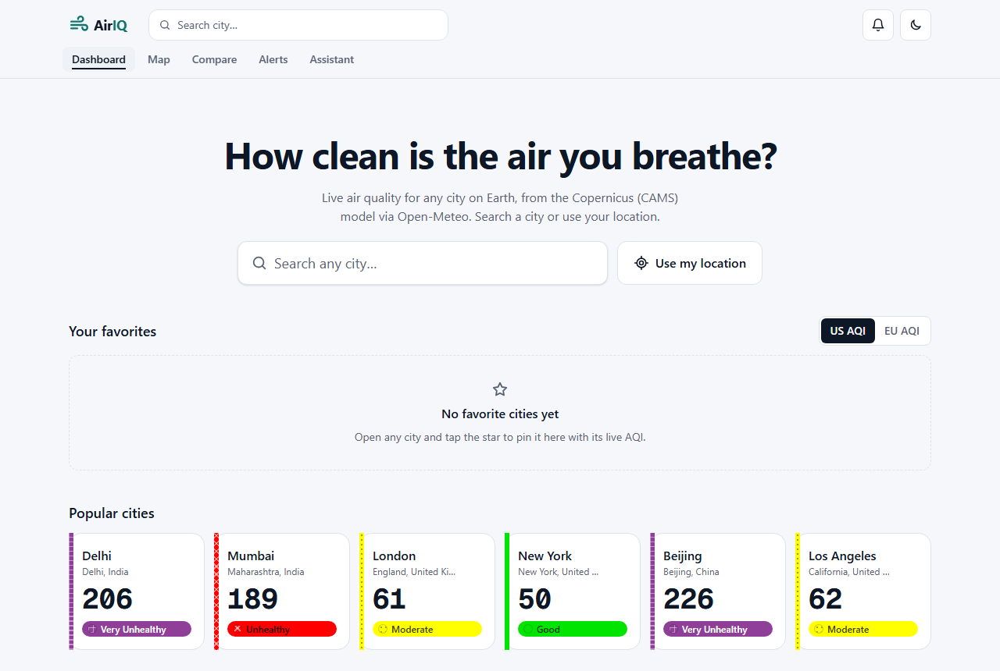 | 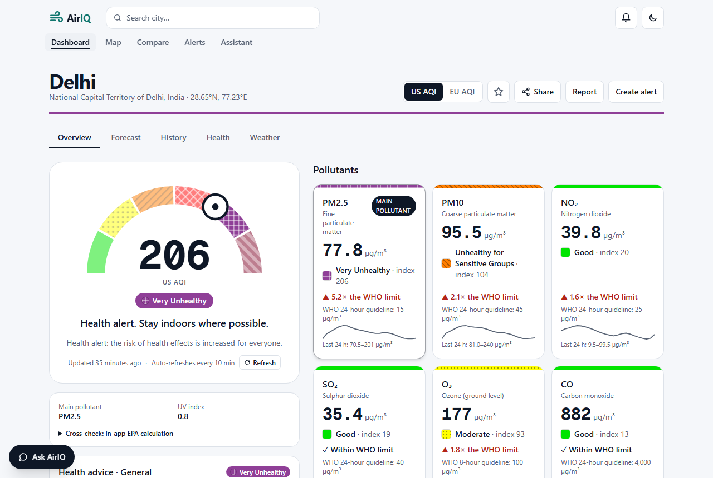 |
| **Home** (`/`) | **City dashboard** (`/city/delhi-28.652-77.231`) |
| 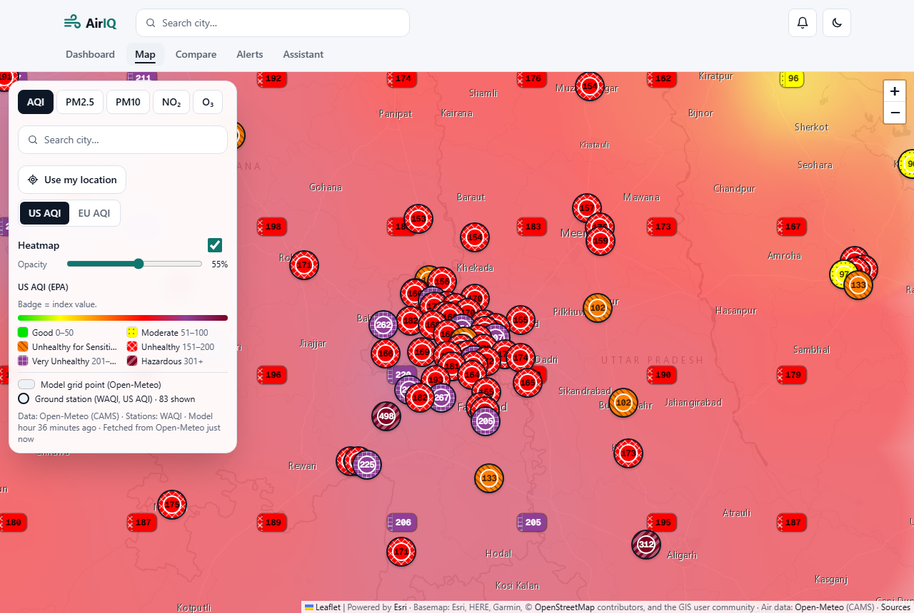 | 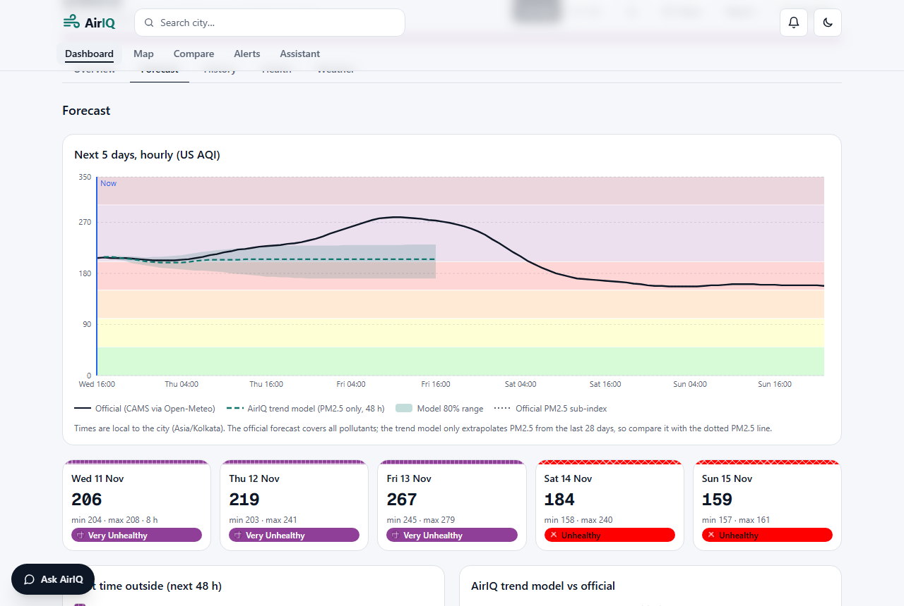 |
| **Map with heatmap and stations** (`/map`) | **Forecast** |
| 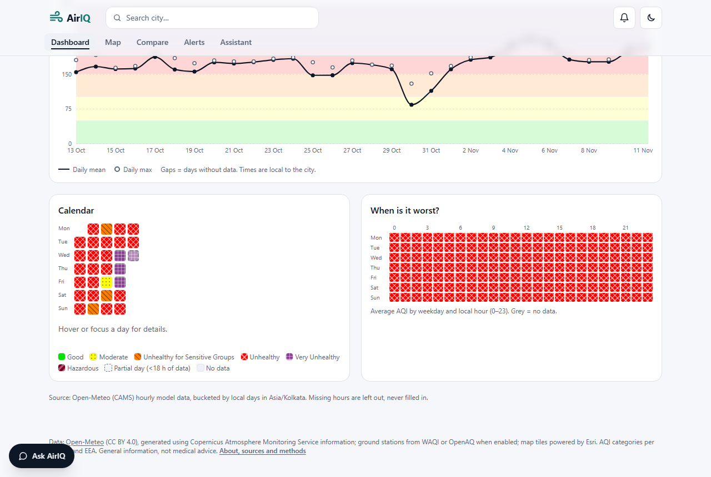 | 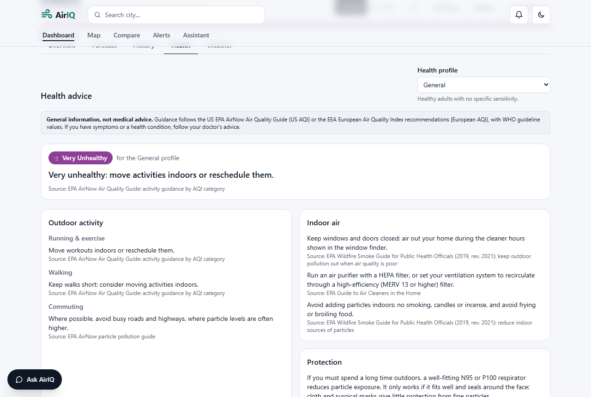 |
| **History: calendar and hour-of-day heatmaps** | **Health advice** |
| 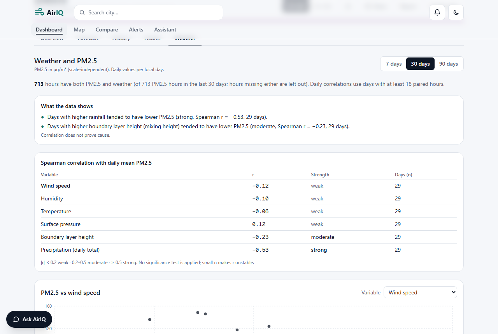 | 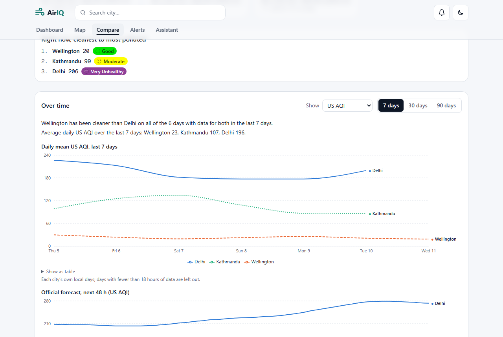 |
| **Weather analytics** | **Compare** (`/compare`) |
| 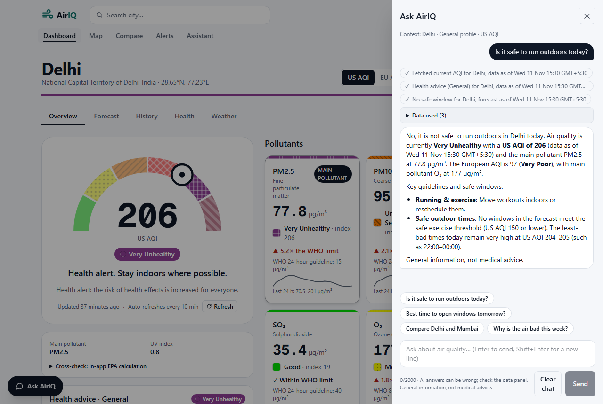 | 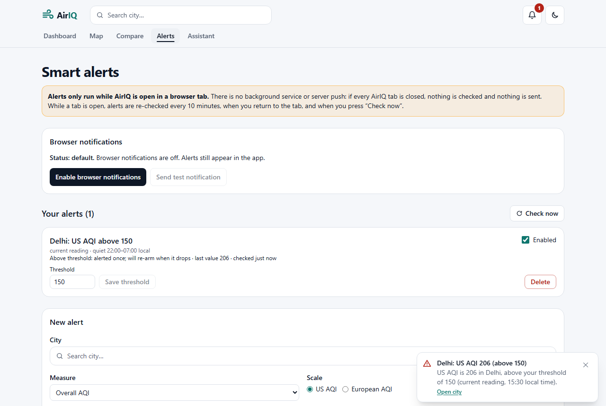 |
| **AI assistant** (real Gemini answer) | **Smart alerts** (`/alerts`) |
| 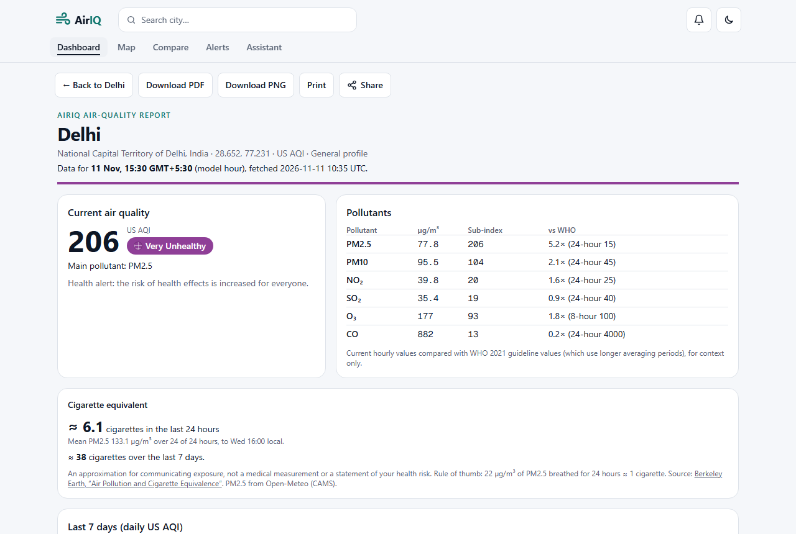 | 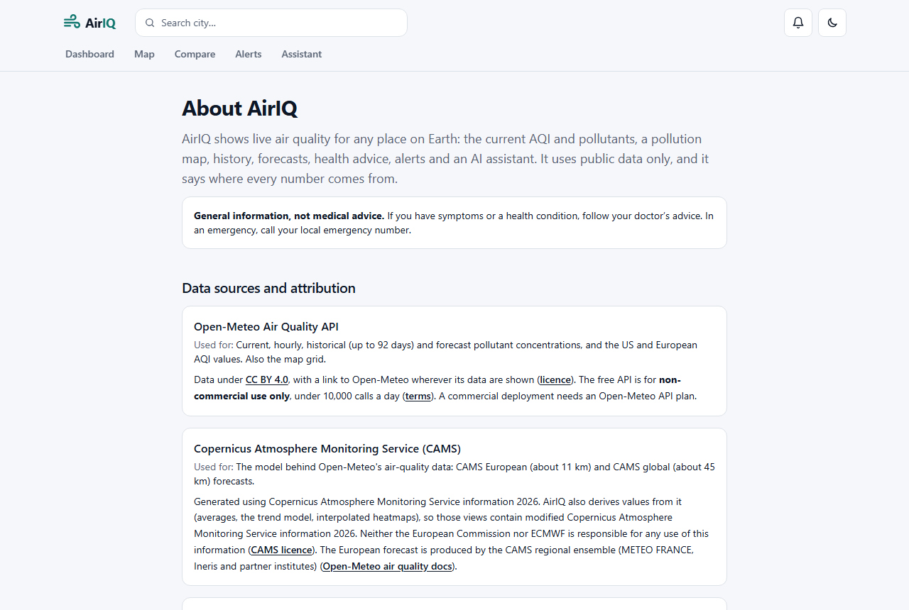 |
| **Shareable report** | **About, sources and methods** |
| 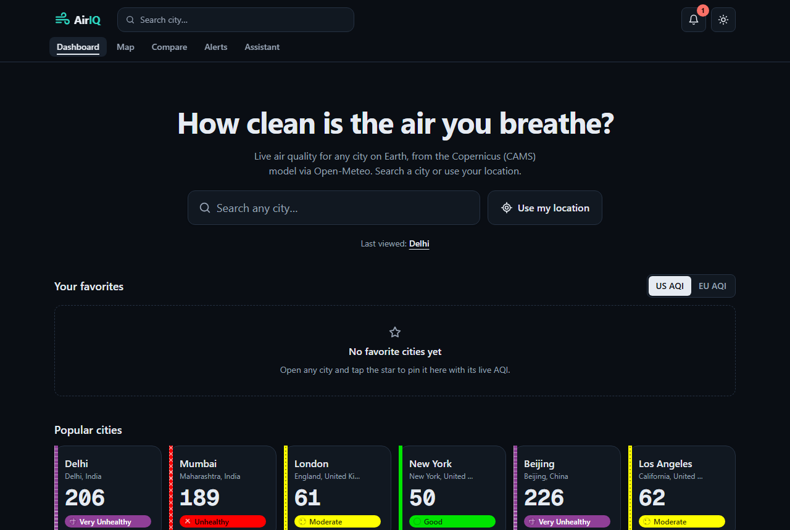 | 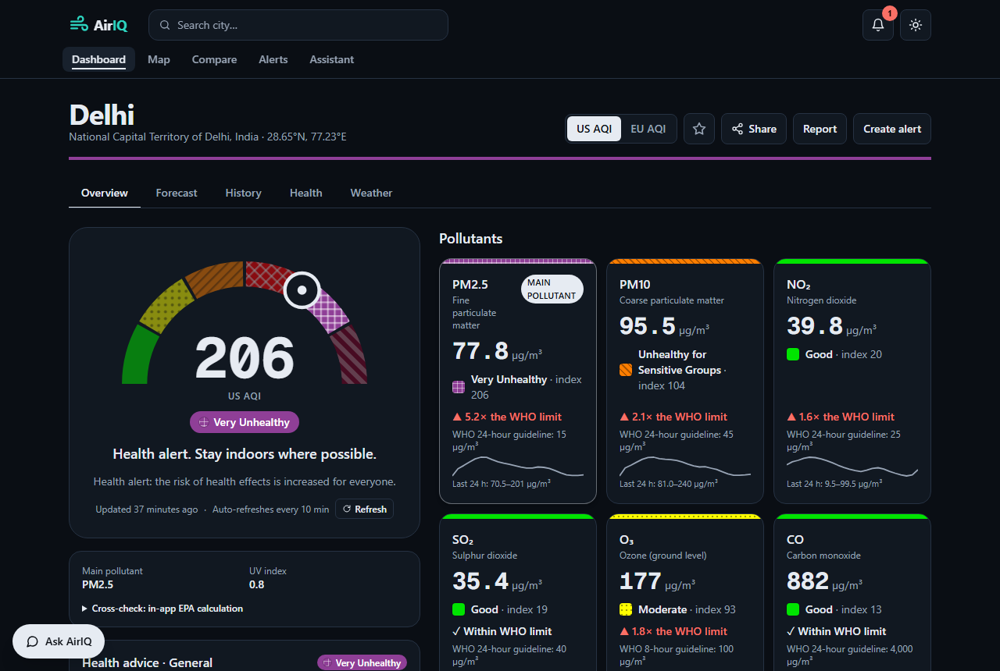 |
| **Home, dark** | **City dashboard, dark** |
| 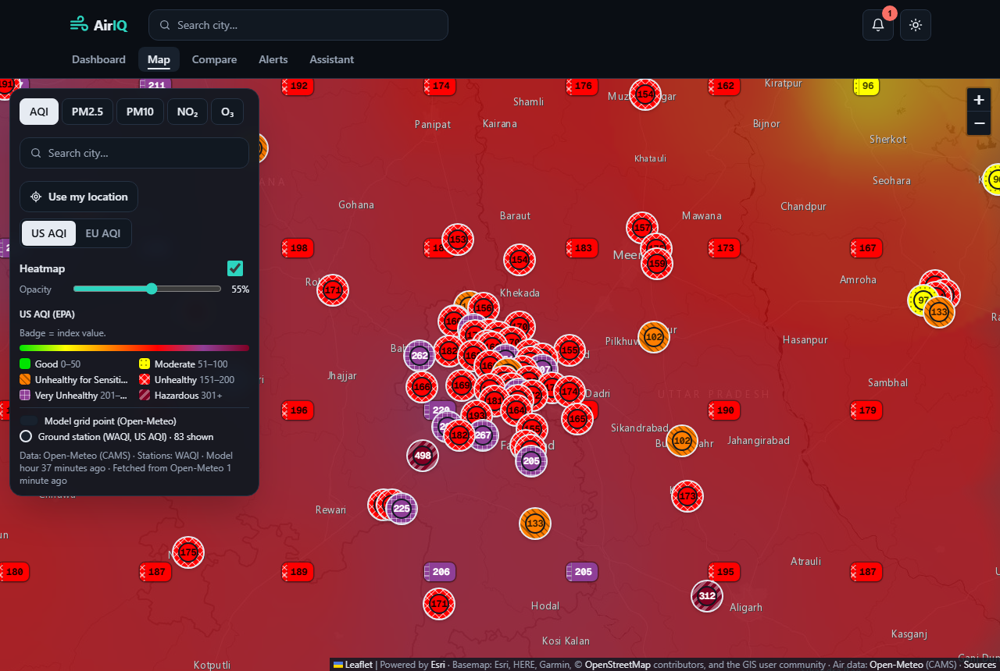 | 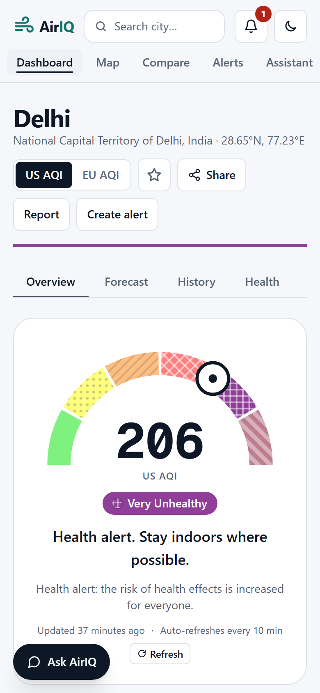 |
| **Map, dark** | **Mobile (390 px)** |

## Challenge items and where they live

| Challenge item | Where | What it does |
| --- | --- | --- |
| **Real-time AQI dashboard** | `/`, `/city/[slug]` | Station-first headline (median of fresh stations within 15 km, else the nearest within 10 km, else the model) with its source, station count, highest station and time; **Data source: Auto / Nearest station / Model only**; US AQI, European AQI and India NAQI; values above an index shown as "500+"; pollution-episode banner; "Stations near you" list; six pollutant cards with WHO ratios and 24 h sparklines; 10-minute auto-refresh. |
| **Interactive map** | `/map` | Ground stations as the primary layer (value or "500+", beyond-index style) over the live Open-Meteo grid; heatmap **Blended / Stations only / Model only**; station popups with dominant pollutant, observation time and age, and the model value at that point; layers for AQI, PM2.5, PM10, NO₂, O₃ on three scales; fly-to search, "Use my location", shareable URL. |
| **Historical tracker** | City → **History** (`?tab=history&range=7\|30\|90`) | Daily mean/max chart with category bands, calendar heatmap, weekday × hour heatmap, best/worst day, change vs previous period, and insights only when the data supports them. |
| **AQI forecasting** | City → **Forecast** | Official 5-day CAMS forecast, plus the AirIQ trend model (damped Holt-Winters, 48 h) with an 80% range and a live backtest against two baselines; daily strip; cleanest 3-hour windows. |
| **AI assistant** | `/assistant`, "Ask AirIQ" on city pages | Gemini with 7 tools (current AQI, history, forecast, compare, health advice, safe windows, city resolution). Every number is checked against the fetched data; "Data used" panel; asks when a city name is ambiguous. |
| **Smart alerts** | `/alerts`, header bell | Rules per city on AQI or a pollutant (US, EU or NAQI), on the current headline (stations first; model when stations are older than 3 h; each event records its source) or the forecast, with NAQI-aware defaults, quiet hours, hysteresis and opt-in notifications. |
| **Heatmaps and analytics** | Map, History, Weather, Compare | IDW heatmap on the map; calendar and hour-of-day heatmaps; weather correlations (Spearman, daily), scatter, wind rose, dry vs rain days; side-by-side comparison of 2–4 cities. |

**Extras:**
- **Health advice** for 6 profiles, from a sourced rules table (EPA, EEA, CPCB, WHO), plus a **safe-time finder**. Hazardous and beyond-index readings always get the strongest guidance.
- **India NAQI** computed from concentrations with CPCB's breakpoints, averaging periods and minimum-data rules ([CPCB, About NAQI](https://web.archive.org/web/20160804011654/http://cpcb.nic.in:80/About_AQI.pdf); [CPCB NAQI report](https://web.archive.org/web/20160417204306/http://www.cpcb.nic.in/FINAL-REPORT_AQI_.pdf)).
- **"Why apps differ"**: `/about` explains modelled vs measured data, scales, averaging and station coverage.
- **Cigarette equivalent** (Berkeley Earth rule of thumb).
- **Shareable report**: PDF, PNG and print, with live Open Graph images.
- **Installable PWA that works offline**, with stale data always labelled.
- **Accessibility:** dark mode, keyboard support throughout, and WCAG AA colours with patterns.

## Architecture

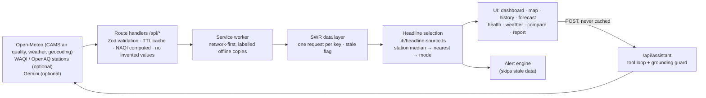

Details: [docs/ARCHITECTURE.md](docs/ARCHITECTURE.md). It covers data flow and caching, AQI logic, the trend model, the alert engine, the service worker, the assistant, and the security headers.

## Tech stack

- **Next.js 16.4** (App Router, Turbopack) with **React 19** and **TypeScript** (strict).
- **Tailwind CSS 4**.
- **SWR** for client data, **Zod 4** for every boundary (upstream responses, query strings, localStorage, environment).
- **Recharts** (charts, lazy-loaded), **Leaflet** + **react-leaflet** (map, `/map` only), a custom canvas IDW heatmap.
- **@google/genai** for the assistant.
- **html-to-image** + **jsPDF** for report export (loaded on demand).
- Tests: **Node's built-in test runner** with native type stripping, plus **axe-core** for accessibility audits.
- A hand-written service worker (no Workbox).

## Project structure

```
app/                  pages, route handlers (api/*), error/not-found boundaries, manifest, OG image, /about
components/           UI: dashboard, gauge, cards, search, tabs
  map/                MapScreen → MapClient (client-only) → MapView (react-leaflet), HeatLayer, markers, popups
  forecast/ history/ weather/ health/ compare/ report/ alerts/ assistant/ pwa/ charts/
hooks/                data and state hooks (useCity, useAlertEngine, useAqiScale, useProfile, useOnline, …)
lib/                  pure logic and server data layer
  aqi.ts, aqi-categories.ts     AQI maths, categories, colours, WHO values
  openmeteo.ts, waqi.ts, openaq.ts, stations.ts, http.ts, cache.ts, schemas.ts, env.ts, zod.ts
  forecast-model.ts, history-stats.ts, weather-stats.ts, alerts.ts, health-rules.ts, stale.ts, …
  assistant/          tool loop, tools, Gemini client, grounding guard, system prompt, rate limit
  __tests__/          unit tests (node --test)
public/sw.js, sw-core.js   service worker (decisions in the pure, tested sw-core.js)
scripts/a11y-audit.mjs     axe-core audit of every route, both themes, desktop and mobile
docs/                 ARCHITECTURE.md, DEMO.md, PHASE8-REPORT.md, screenshots/
instrumentation.ts    validates the environment at startup (no values logged)
.github/workflows/ci.yml   install, typecheck, lint, test, build on push and pull request
```

## Setup

Requires **Node.js ≥ 22.18**.

```bash
git clone <this repository> airiq && cd airiq
npm ci
cp .env.example .env.local      # optional: add keys (all features work without them except stations and the assistant)
npm run build && npm start      # production server on http://localhost:3000 (service worker and offline mode)
```

For development, use `npm run dev` instead of the last line. The service worker is not registered in dev.

## Environment variables

All variables are **optional**. They are validated once at startup in `lib/env.ts` (logged as on/off, never with values). A missing or invalid value never crashes the app: the feature switches off and the UI says why. Keys are read only on the server.

| Variable | Required? | What it unlocks | Without it |
| --- | --- | --- | --- |
| `WAQI_TOKEN` | Optional | The station-first headline, "Stations near you", station map markers and the blended heatmap (preferred source). [Free token](https://aqicn.org/data-platform/token/) | Falls back to OpenAQ, or the model with a visible "No nearby station data" note |
| `OPENAQ_API_KEY` | Optional | Ground stations from OpenAQ (backup source) and the **station-based** India NAQI from a station's own concentrations. [Free key](https://explore.openaq.org/register) | No OpenAQ fallback; NAQI is model-based |
| `GEMINI_API_KEY` | Optional | The AI assistant. [Free key](https://aistudio.google.com/apikey) | "Assistant not configured"; everything else works |
| `GEMINI_MODEL` | Optional | Override the model | `gemini-3.6-flash` |
| `GEMINI_FALLBACK_MODEL` | Optional | Backup model used once on a quota error; `off` disables it | `gemini-3.5-flash-lite` |
| `GEMINI_BASE_URL` | Optional, testing only | Send Gemini calls to a mock server | Google's API |
| `SITE_URL` | Optional (set in production) | Absolute base for Open Graph image links | `http://localhost:3000` |
| `AIRIQ_BUILD_VERSION` | Optional, build time | Service-worker cache version | The build timestamp |

`/about` shows which optional features are on for the running server.

## API routes

| Route | Source | Notes |
| --- | --- | --- |
| `GET /api/air?lat=&lon=` | Open-Meteo Air Quality | Current reading, last 24 h, sub-indices on all three scales (NAQI computed by AirIQ), EPA cross-check. Cached 10 min |
| `GET /api/history?lat=&lon=&days=7\|30\|90` | Open-Meteo Air Quality (`past_days`) | Hourly AQI (both scales) and 6 pollutants; fetches 2× the range (max 92 days) for period comparison. Cached 30 min |
| `GET /api/forecast?lat=&lon=` | Open-Meteo Air Quality + Weather (sunrise/sunset) | Official forecast, AirIQ trend model, backtest, 80% range. Cached 15 min |
| `GET /api/weather?lat=&lon=&days=7\|30\|90` | Open-Meteo Weather | Hourly temperature, humidity, wind, pressure, precipitation, boundary layer height. Cached 30 min |
| `GET /api/grid?south=&west=&north=&east=&zoom=` | Open-Meteo Air Quality (one batched multi-location call) | ≤ 64 snapped grid points for the map. Cached 10 min; 400 on inverted or oversized bounds |
| `GET /api/stations?south=&west=&north=&east=&zoom=` | WAQI `/map/bounds/` → OpenAQ v3 | Map viewport mode. `{ source: "none" }` when no key is set. Cached 10 min |
| `GET /api/stations?lat=&lon=[&radius=15]` | WAQI `/map/bounds/` → OpenAQ v3 (+ OpenAQ hourly concentrations for NAQI) | Nearby mode: stations within the radius, nearest first (≤ 40), with distance and observation time, plus `stationNaqi` when OpenAQ is set. A failing feed returns `status: "error"` (HTTP 200) so the page falls back to the model. Cached 10 min |
| `GET /api/station?id=waqi-123` | WAQI `/feed/@uid/` | Popup detail: dominant pollutant, observation time, per-pollutant **index** values. Cached 10 min |
| `GET /api/geocode?q=&count=&lang=` | Open-Meteo Geocoding | City search. Cached 24 h |
| `GET /api/assistant` | n/a | `{ configured, model, fallbackModel }`, never the key |
| `POST /api/assistant` | Google Gemini + AirIQ tools | `{ messages, context? }` → `text/event-stream`. 503 without a key, 429 + `Retry-After` when rate-limited, 400 on bad input |
| `GET /city/[slug]/opengraph-image` | Open-Meteo Air Quality | 1200×630 PNG with the live AQI; neutral card if data fails |

Everything upstream is validated with Zod. Failures return `{ error, detail }` with a 4xx/5xx status, and nothing is ever filled in. The browser also calls **Esri** basemap tiles and, for "Use my location" only, **BigDataCloud**'s free client-side reverse geocoder.

## Testing

| Command | What it checks |
| --- | --- |
| `npm run typecheck` | `tsc --noEmit`, strict |
| `npm run lint` | ESLint (Next core-web-vitals + TypeScript), plus a rule that Zod is imported only through `lib/zod.ts` |
| `npm test` | 349 unit tests (`node --test`) |
| `npm run check` | All three |
| `node scripts/a11y-audit.mjs http://localhost:3000` | axe-core (WCAG 2.2 AA + best practice) on 12 routes × light/dark × desktop/mobile against a running production server; exits 1 on any serious or critical issue |

The unit tests cover:
- the AQI maths (EPA and EEA), category colour contrast, and the trend model and its backtest;
- history, weather and compare statistics, and health rules (every combination);
- alert evaluation, hysteresis and quiet hours, and skipping stale data;
- service-worker strategy logic, stale-header parsing and time zones;
- shared-link settings, storage validation, environment validation;
- the assistant's tool loop, grounding guard and fallback model;
- Phase 9: station selection (≥ 3 stations median, single station, too far, too old, none, token missing, feed error), the 25% divergence note, NAQI sub-indices at every CPCB breakpoint edge and the CPCB worked example, averaging and minimum-data rules, station-based NAQI unit conversion, beyond-index values in categories, gauge, chart axes, heatmap colours and alerts, heatmap blending, health rules at the top rank, scale and data-source switching in shared links.

Each phase was also verified in headless Chrome against the production build with live data. The Phase 8 run is recorded in [docs/PHASE8-REPORT.md](docs/PHASE8-REPORT.md) and the Phase 9 run (stations, NAQI, beyond-index) in [docs/PHASE9-REPORT.md](docs/PHASE9-REPORT.md).

CI ([.github/workflows/ci.yml](.github/workflows/ci.yml)) runs install, typecheck, lint, tests and the production build on every push and pull request. No keys are needed.

## Deployment

1. **Vercel** (simplest): import the repository, then set `SITE_URL` and any optional keys in Project → Environment Variables. Builds use `npm run build`. Vercel compresses API responses automatically.
2. **Any Node host:** `npm ci && npm run build && npm start` (port 3000, or `-p`). Put a reverse proxy (nginx, Caddy) in front for HTTPS and gzip/brotli. `next start` compresses pages and static files but **not** route-handler JSON (see Decisions).
3. Set `SITE_URL` to the public URL so Open Graph images are absolute. Optionally set `AIRIQ_BUILD_VERSION` (e.g. the commit SHA) to name the service-worker caches.
4. **HTTPS is required** for the service worker, notifications, geolocation and install (localhost is exempt).

Before a public or commercial launch:
- Open-Meteo's free API is **non-commercial only**.
- WAQI data may not be used in paid services.
- Review Esri's basemap terms.
- The assistant's rate limiter is in memory (per instance). Use a shared store if you run several instances.

## Data sources and attribution

AirIQ shows the required credits in the footer of every page, on the map, and in full on `/about`. Requirements were checked on the providers' own pages on 11 Nov 2026:

- **Open-Meteo**: data under CC BY 4.0, with a link to Open-Meteo where its data appear ([licence](https://open-meteo.com/en/licence)). The free API is for non-commercial use, under 10,000 calls a day ([terms](https://open-meteo.com/en/terms)). Geocoding is based on GeoNames ([geocoding docs](https://open-meteo.com/en/docs/geocoding-api)).
- **Copernicus Atmosphere Monitoring Service**: "Generated using / Contains modified Copernicus Atmosphere Monitoring Service information [year]", with the CAMS European ensemble partners credited ([CAMS licence](https://apps.ecmwf.int/datasets/licences/cams), [Open-Meteo air quality docs](https://open-meteo.com/en/docs/air-quality-api)).
- **WAQI**: attribution to the World Air Quality Index Project and the originating EPA is mandatory. No sale, no paid apps, no redistribution as cached or archived data ([WAQI API terms](https://aqicn.org/api/)).
- **OpenAQ**: attribution to OpenAQ, and to original providers where they require it ([OpenAQ terms](https://docs.openaq.org/about/terms)).
- **Esri**: "Powered by Esri" plus the service's data credits ("Esri, HERE, Garmin, © OpenStreetMap contributors, and the GIS user community", read from the tile service's `copyrightText`) ([Esri attribution requirements](https://developers.arcgis.com/documentation/esri-and-data-attribution/)).
- **BigDataCloud**: the free client-side reverse geocoder may only be called from the browser with the device's current location ([BigDataCloud terms](https://www.bigdatacloud.com/free-api/free-reverse-geocode-to-city-api)).
- **CPCB (India)**: NAQI breakpoints, averaging periods and worked example from [About National Air Quality Index](https://web.archive.org/web/20160804011654/http://cpcb.nic.in:80/About_AQI.pdf); minimum-data rules (§3.7) and health statements (Table 3.12) from the [National Air Quality Index report](https://web.archive.org/web/20160417204306/http://www.cpcb.nic.in/FINAL-REPORT_AQI_.pdf). Both are archived copies of cpcb.nic.in, which did not respond on 14 Nov 2026. AirIQ computes NAQI itself; it may differ from CPCB's official bulletin.
- **Berkeley Earth**: 22 µg/m³ of PM2.5 for a day ≈ 1 cigarette, a rough illustrative comparison ([Air Pollution and Cigarette Equivalence](https://berkeleyearth.org/air-pollution-and-cigarette-equivalence/)).

## Limitations

- **Grid data is modelled, not measured.** CAMS cells are about 11 km (Europe) to 45 km (elsewhere) and smooth out local hot spots, so AirIQ prefers fresh ground stations for the headline. Stations are optional, vary widely in coverage, often report 1–3 h late, and publish a US AQI only (WAQI), so the European AQI and (without OpenAQ) the NAQI come from the model.
- **NAQI is AirIQ's calculation**, not CPCB's bulletin, and was not compared with the official bulletin directly. History, forecast and map NAQI always use model concentrations.
- **Alerts only run while an AirIQ tab is open.** There is no push server.
- **Offline data is the last saved copy**, always labelled with its time, and alerts never run on it. A view never opened online is not available offline.
- **History is limited** to about 92 days (Open-Meteo), and the weather archive can be shorter.
- **The trend model is a simple statistical model.** It is backtested on only 48 h each time and sometimes loses to a naive baseline (the UI says so).
- **The assistant can be wrong.** Numbers are checked against tool data, but wording is not. The free Gemini tier allows about 20 requests per day per model.
- **Not verified:**
  - a click on a real OS notification;
  - the browser's install dialog and the installed app window;
  - real phones and tablets (only emulated mobile viewports);
  - behaviour at production scale (multi-instance rate limiting, upstream quotas under load).

## AirIQ trend model

A transparent, dependency-free model in [`lib/forecast-model.ts`](lib/forecast-model.ts). It forecasts **hourly PM2.5** 48 h ahead. It is compared with the official forecast, never ranked above it.

**Method: additive Holt-Winters with a damped trend and a 24-hour season, on x = ln(1 + PM2.5).** With h(t) the city's true local hour:

```
forecast  x̂(t+k) = ℓ(t) + (φ + φ² + … + φᵏ)·b(t) + s[h(t+k)]
level     ℓ(t)   = α·(x(t) − s[h(t)]) + (1 − α)·(ℓ(t−1) + φ·b(t−1))
trend     b(t)   = β·(ℓ(t) − ℓ(t−1)) + (1 − β)·φ·b(t−1)
season    s[h(t)] ← γ·(x(t) − ℓ(t)) + (1 − γ)·s[h(t)]
output    PM2.5 = max(0, e^x̂ − 1)
```

- **Training data:** the last 28 days of hourly PM2.5 (Open-Meteo/CAMS), up to the current hour. The season starts as the per-hour mean minus the overall mean of the first 7 days.
- **Missing hours never update the state.** Level and trend roll forward and the season is left alone, so gaps are never filled with invented values.
- **Parameters:** α ∈ {0.05…0.7}, β ∈ {0, 0.02, 0.1}, γ ∈ {0.05, 0.15, 0.3}, φ ∈ {0.85, 0.95}, chosen by grid search on **multi-step** error (forecasts 1–24 h ahead from an origin every 6 h). Scoring by one-step error alone picked α = 0.7, which chased short-lived noise and biased the 24–48 h forecasts.
- **Backtest:** hold out the last 48 h, fit on the rest only, and report PM2.5 MAE and RMSE for the model, **persistence** (last value) and **seasonal-naive** (same local hour on the last training day), compared on the same hours. A unit test proves that changing the held-out hours does not change any prediction.
- **80% range:** the 10th–90th percentile of residuals (actual − predicted) from rolling-origin backtests (origins every 24 h over the last week; parameters fitted only on data before the earliest origin), separately for 1–6 h, 7–24 h and 25–48 h ahead. If the model has recently been biased, the range can sit entirely above or below its line; the UI says so.
- **On the AQI scale:** US uses the EPA index of the trailing 24-h mean (observed hours + predictions); EU uses the hourly EEA bands. These match how Open-Meteo builds its PM2.5 sub-indices, so the model line is compared with the official **PM2.5 sub-index** (dotted). The official headline line includes all pollutants. Converting the 80% range through the 24-h mean is an approximation.
- **Refusal:** with fewer than 216 valid hours (7 days + the 48-h holdout), more than 25% of hours missing, or too few residuals for every horizon bucket, the UI shows "Not enough data for a trend model".

**Backtest results on live data (2026-11-10, PM2.5 MAE / RMSE in µg/m³, last 48 h held out):**

| City | Model | Persistence | Seasonal-naive | Verdict |
| --- | --- | --- | --- | --- |
| Delhi | 22.5 / 26.8 | 32.7 / 42.9 | 25.0 / 29.9 | beats both |
| Beijing | 37.9 / 46.8 | 61.4 / 74.0 | 58.1 / 70.2 | beats both |
| New York | 2.4 / 2.8 | 2.9 / 3.1 | 7.2 / 10.2 | beats both |
| Los Angeles | 4.6 / 5.7 | 6.2 / 7.4 | 4.9 / 6.0 | beats both (narrowly) |
| Mumbai | 7.1 / 9.9 | 10.2 / 13.7 | 6.8 / 8.6 | **loses to seasonal-naive** |
| London | 12.5 / 13.3 | 9.4 / 10.7 | 8.9 / 10.2 | **loses to both** |

These change every hour with new data. The UI always shows the current numbers and says plainly when the model does not beat a baseline.

## Decisions

### Phase 9: station-first headline, extreme values, India NAQI

- **Checked the claim first.** On 14 Nov 2026 (21:48 IST) WAQI showed no Delhi-NCR station above 500: maximum 440 (Anand Vihar), median 215 over 67 stations, 9 above 300. The model said 177 at Delhi's centre. The extreme-value handling was built anyway and tested with intercepted data. See [docs/PHASE9-station-check.txt](docs/PHASE9-station-check.txt).
- **Median of stations, not the nearest or the maximum.** One station near a road or a fire can dominate; the median of ≥ 3 fresh stations within 15 km is robust, and the highest station is always shown next to it. One fresh station within 10 km is used on its own; otherwise the model.
- **3-hour freshness.** WAQI stations often report late; older readings are listed but never drive the headline or alerts (Sonipat's only station, Murthal, was 3.5 h old during testing, so Sonipat used the model and said why).
- **No conversions between scales.** WAQI publishes US AQI index values, not concentrations, so they are never turned into µg/m³, the European AQI or NAQI. NAQI comes from concentrations only (station-based via OpenAQ, else model-based) and is labelled as AirIQ's calculation.
- **Severe and beyond.** CPCB's Severe band is open-ended; AirIQ continues the Very-poor slope (PM2.5 251–380, PM10 431–510 for 401–500) and keeps values above 500, displayed "500+". The US index likewise extends its top band instead of clipping, with a new dark-maroon zigzag "Beyond index" category (rank 5, so health rules give it the Hazardous guidance).
- **Episodes are never hidden by a smoother scale.** The banner fires on the headline (US ≥ 201, NAQI Very poor/Severe, EU Very poor+) and also when nearby stations read US 201+ while the headline is model-based (EU/NAQI scales or "Model only").
- **NAQI colours** follow CPCB's green → dark-red legend with AirIQ hex values chosen for WCAG AA text contrast; Very poor uses white text on `#d7191c` (5.2:1).
- **Heatmap zero-size guard.** The intermittent `IndexSizeError` seen in the Phase 8 tour (canvas measured 0 px for a frame) is now skipped instead of thrown.

### Phase 8: verification, polish, submission readiness

- **AQI badge text meets WCAG AA in both themes.** White text on EPA "Unhealthy" red (`#ff0000`, 4.0:1) and EEA "Poor" (`#ff5050`, 3.2:1) failed AA. Both now use near-black `#1a0000` (5.0:1 and 6.2:1). The official background colours and the patterns are unchanged. The dark-theme danger badges (alert count, "New") had white on `#f97066` (2.8:1) and now use a `--danger-contrast` token. A unit test checks every category pair and the theme tokens against 4.5:1, so this can't regress.
- **Map markers and WCAG 2.5.8 (target size).**
  - Grid badges are now 24 px tall.
  - Overlapping station markers in dense cities remain an axe finding at desktop width. WCAG's Understanding document puts map pins under the **Essential** exception: their position is the information.
  - The alternatives it asks for exist. Zooming in separates the pins, every place is reachable through search and its city page, and every marker is keyboard-focusable.
- **Keyboard fixes found in the keyboard pass:**
  - The skip link now moves focus into `<main>`.
  - Picking a city in the alert form focuses "Change".
  - Adding or removing a city in Compare keeps focus in the city picker.
  - A map popup opened from the keyboard takes focus. Escape closes it from anywhere in the map and returns focus to its marker (Leaflet handles Escape only when the map container itself is focused).
- **Reduced motion:** the CSS already disabled animations and transitions. Leaflet's JavaScript animations (fly-to, zoom, fade) now also switch off when `prefers-reduced-motion: reduce` is set. Charts never animate.
- **Charts stay off the Overview.** Next prefetched `/compare` (header link) and the report (city page), whose views imported Recharts statically, so the 110 KB chart chunk loaded on every page. The compare charts and the report chart are now lazy, and `categoryBands` moved out of `chart-kit` so colour helpers don't pull Recharts in. Measured: Overview, home, alerts, assistant and about load no chart library, and Leaflet loads only on `/map`.
- **No prefetch for dynamic city links.** Prefetching a city page renders it on the server, which spent upstream calls (geocoding, live AQI) for pages the user may never open. With the six home cards, a home view made 15 Open-Meteo requests; with `prefetch={false}` it makes 6.
- **One server cache for pages and routes.** The in-process cache lived in module scope, and Next bundles pages and route handlers separately. A city page's metadata and `/api/air` therefore fetched the identical URL twice. The cache now lives on `globalThis`. Measured on a cold server: home 6 Open-Meteo requests, a city page 3 (geocoding, current, 14-day history), the map 1 grid call plus 1 station call.
- **No gzip for API JSON under `next start`.**
  - Gzip in `jsonOk` was tried and reverted. Unit tests passed, but in the browser every API call failed: `next start` strips the `Content-Encoding` header from route-handler responses while still sending the compressed bytes.
  - Compression of API JSON is left to the host (Vercel and common reverse proxies do it). Lighthouse's "text compression" finding on the city page (the 136 KB 7-day history) is therefore a `next start` artefact.
- **System UI font.** Geist sans was preloaded on every page but never applied: `@theme inline` inlines `--font-sans` into utilities rather than defining it as a variable, so the stylesheet's `var(--font-sans)` was invalid. The unused font download was removed, and the system stack the app has always rendered with is now explicit. The map badges had the same problem with `--font-mono` and now use Geist Mono as intended.
- **Error states.**
  - `app/error.tsx` offers "Try again" (Next 16's `retry`) and "Go to the dashboard", and shows only the error digest.
  - `app/global-error.tsx` carries its own minimal styles.
  - `app/not-found.tsx` explains the city-link format and offers search.
  - An invalid city slug returns a **real 404**. A `loading.tsx` for city pages was tried and removed: with a loading boundary Next streams the page and fixes the status at 200 before `notFound()` runs (a "soft 404"). The other routes are static, so they need no loading file.
- **Environment in one place** (`lib/env.ts`, Zod). Every variable is optional. Empty values count as unset. Invalid URLs or model ids are ignored with a warning naming only the variable. `instrumentation.ts` logs the on/off summary at startup, and `/about` shows it. A unit test checks that no secret value can appear in warnings, feature details or the log line.
- **Security headers:** `X-Content-Type-Options`, `Referrer-Policy`, `X-Frame-Options: DENY`, and a Permissions-Policy allowing only geolocation for this origin. An **enforced** CSP (not report-only) was tested in the browser with the map tiles, the service worker, offline mode, report export and the assistant stream, and no violations were reported.
  - `'unsafe-inline'` scripts are needed for Next's inline RSC payload and the theme script; nonces would make every static page dynamic.
  - Zod 4 probes `new Function` once (caught, but reported as a CSP violation, which Lighthouse flagged). All Zod imports now go through `lib/zod.ts`, which sets `jitless`, and a lint rule enforces it.
- **`npm audit`: 0 vulnerabilities.** It started with 8 moderate findings, all one minimatch ReDoS advisory reached only through the dev-only lint toolchain (`eslint-config-next` → `typescript-eslint` → `minimatch@10.2.6`). npm's suggested fix was a downgrade to `eslint-config-next@15`. Instead, an `overrides` entry pins that one path to `minimatch@^11.0.7`. Lint still parses and reports TypeScript correctly.
- **BigDataCloud is used only for "Use my location".** Its free client-side endpoint may be called only with the device's current location. Map points therefore keep their "Map point (lat, lon)" label instead of being reverse-geocoded.
- **Attribution:** the footer on every page and the map attribution now carry the required credits ("Powered by Esri" with the tile service's copyright text, Open-Meteo CC BY 4.0, Copernicus CAMS). `/about` lists every provider's terms with links. The footer clears the floating "Ask AirIQ" button.
- **Lighthouse (mobile, final build):** Accessibility, Best Practices and SEO are 100 on home and the city page. Performance is home 85–91, city 81–82 and map 56. The city page misses 90 because its largest element needs the live reading, which is fetched in the browser after the JS (that is what keeps offline data labelled). Real unthrottled LCP was 0.35–0.40 s; Lighthouse's slow-4G simulation gives 4.6 s. Preloading the request was tried and reverted (Chrome fetched it twice with `cache: "no-store"`). Full numbers: [docs/PHASE8-REPORT.md](docs/PHASE8-REPORT.md).
- **Removed:** the unused `components/ComingSoon.tsx`. Every runtime dependency is in use; no stray `console.log` (only `console.error` for server errors and the startup summary).

### Phases 1–4: data, dashboard, map, history and forecast

- **Next.js 16.4.5** instead of the 15.x that `create-next-app@15` installs, because 15.x has open security advisories.
- **Tests use Node's built-in runner** (`node --test` with native type stripping) instead of Vitest. `npm install vitest` repeatedly crashed with an npm 10.9 internal error (`edgesOut`), and Vitest 4/5 don't officially support Node 23. The tested modules (`lib/aqi.ts`, `lib/aqi-categories.ts`) use relative `.ts` imports so they run without a bundler.
- **EPA breakpoints: May 2024 revision** (PM2.5 "Good" ≤ 9.0 µg/m³). The 2012 PM2.5 table is kept as an option for reference.
- **Headline AQI = Open-Meteo's `us_aqi` / `european_aqi`.** The in-app EPA calculation (proper 24 h / 8 h / 1 h averaging windows) is shown as a cross-check. Verified live: PM2.5 sub-indices match Open-Meteo exactly. Ozone can differ because Open-Meteo uses a different 8-hour window convention.
- **Dominant pollutant** comes from Open-Meteo's per-pollutant sub-indices (`us_aqi_pm2_5`, …), so it always agrees with the headline number. The European index has no CO component.
- **Gas unit conversion** µg/m³ → ppb/ppm at 25 °C, 1 atm (EPA reference conditions, molar volume 24.45 L).
- **WHO guideline comparison** uses WHO 2021 AQG values. For hourly readings: 24-hour guidelines for PM/NO₂/SO₂/CO and the 8-hour guideline for O₃.
- **Times** are normalized to UTC ISO strings. Each series keeps its `utcOffsetSeconds` so local hour-of-day patterns can still be computed.
- **Caching:** an in-process TTL cache (10 min for air data) with in-flight de-duplication, plus `Cache-Control` headers for CDNs. Upstream fetches use `cache: "no-store"`: Next's persistent fetch cache was removed after it served hours-old readings following an idle period (found during the real-Gemini verification).
- **Shareable city URLs** are `/city/<name>-<lat>-<lon>` with 3-decimal coordinates (~100 m), e.g. `/city/new-york-40.714--74.006`. The coordinates in the slug are authoritative. The server looks the name up in the geocoder only to recover "Region, Country" (same name within 50 km), and falls back to the slug name if the geocoder fails.
- **"Use my location"** navigates as soon as coordinates are known, to `/city/your-location-<lat>-<lon>`. The page loads air data right away and resolves a place name from BigDataCloud's free client endpoint in the background. When the name arrives, the URL is swapped (no reload) for a shareable named slug. If the lookup fails, the label stays "Your location (lat, lon)".
- **Gauge bands have equal width** (six per scale) so the low end stays readable on a 0–500 scale. The marker interpolates inside its band.
- **Pollutant card colors** come from Open-Meteo's per-pollutant sub-index on the active scale. The European index has no CO component, so the CO card says so instead of showing a color.
- **WHO comparison** compares the current hourly concentration with the WHO 2021 24-hour guideline (8-hour for O₃). This is an indicator, not a formal exceedance.
- **Errors show immediately.** SWR keeps retrying in the background, but the user sees the error and a Retry button (which shows "Retrying…") rather than a long skeleton. On a failed refresh, the last successful reading stays visible with a "Refresh failed" notice.
- **Theme** defaults to the OS preference until the user picks one.
- **Popular cities** are a fixed list of coordinates. Their readings are always fetched live.
- **Basemap: Esri World Light/Dark Gray Canvas instead of CARTO.** The spec asked for CARTO light/dark tiles, but on 2026-11-10 every CARTO basemap URL returned an "API KEY REQUIRED" watermark tile, which would break the zero-keys rule. Esri's gray canvas tiles need no key, come in matching light/dark styles, and are attributed on the map. A separate Esri label layer sits above the heatmap so place names stay readable. Esri's terms allow this for non-commercial and development use; a production deployment should review Esri's or another provider's terms.
- **Grid snapping.** Grid points sit on multiples of a "nice" step (0.1°, 0.2°, 0.25°, 0.5°, 1°, …). The finest step depends on zoom (~16 points across a typical viewport); the grid coarsens until it fits 64 points. Slightly panned views produce identical points, so they share cache entries. A viewport larger than a 16-tile-wide screen at its zoom is rejected with a 400.
- **One request per grid.** All grid points go to Open-Meteo in a single comma-separated multi-location request. If Open-Meteo fails or rate-limits (429 is passed through), the route returns that error and the map keeps the last successful view with an error banner. It never fills gaps with invented values.
- **Map colors follow the app's AQI toggle.** The AQI layer uses US or European AQI; pollutant layers are colored by that pollutant's Open-Meteo sub-index on the active scale, while badges show the concentration in µg/m³.
- **Heatmap** is a custom canvas layer (no leaflet.heat). It interpolates grid values in screen space with inverse-distance weighting (power 2), draws at 1/6 resolution with smoothing, and fades out beyond ~1.6 grid spacings so it never paints far past real data.
- **Ground stations** report a US AQI only. WAQI's map endpoint gives the network's AQI but not the dominant pollutant or per-pollutant values, so the popup says so. OpenAQ gives the latest hourly PM2.5, from which AirIQ computes an instantaneous US AQI, labeled as such. Stations without a numeric, recent (≤6 h) value are dropped. OpenAQ is capped at 20 stations per view to respect its free rate limit. Stations show on the AQI and PM2.5 layers only.
- **Station path testing:** no WAQI or OpenAQ key was available. The station UI was verified against a mocked `/api/stations` response in the browser, and the server path was tested live with invalid keys (WAQI "Invalid key" → OpenAQ 401 → clean 502, map still works). The successful live parsing of WAQI/OpenAQ responses has **not** been verified against real data.
- **Stale responses never win.** Map requests are debounced 500 ms. Each new request aborts the previous one, and a sequence check ignores any response that is not the latest.
- **Unnamed map points** link to `/city/map-point-<lat>-<lon>` and are labelled "Map point (lat, lon)". **Changed in Phase 8:** they used to be reverse-geocoded through BigDataCloud like "Use my location", but its free endpoint may only be used with the device's own location.
- **`turbopack.root` is pinned** to the project folder in `next.config.ts`. A stray `package-lock.json` in a parent folder (here, the user's home directory) otherwise made the dev server watch far more than the project, and it fell into a full-reload loop while a browser was open.
- **Local time (fix to Phase 1's handling).** Open-Meteo's `timezone=auto` labels every hour with ONE fixed offset (the zone's current one), not true wall-clock time. This was verified live: London returned 24 hourly stamps on 2026-10-25, the day BST ended. Phase 1's UTC conversion (label − `utc_offset_seconds`) is therefore exact, but bucketing by Open-Meteo's local labels would put London's summer days an hour off. AirIQ now derives the true local date, hour and weekday from UTC with the IANA zone (`lib/time.ts`), for daily buckets, hour-of-day patterns, "today" and chart labels. The browser's own time zone is never used.
- **European PM2.5 index** (`euPm25Index` in `lib/aqi.ts`) uses the HOURLY concentration with the 2024 EEA bands (0–5–15–50–90–140 µg/m³ → 0–20–40–60–80–100), continuing above 140 µg/m³ with the last band's slope. This was reverse-checked against 744 hourly Open-Meteo values each for Delhi and London: exact below 140 µg/m³, within ±1 above.
- **History periods** are the N local days ending today, inclusive; today is usually a partial day. Days with fewer than 18 valid hours are "partial": they are shown dashed and faded in the calendar and excluded from best/worst unless no full day exists. Hour-of-day cells need at least 3 samples. "vs previous period" needs at least 75% coverage of the earlier period and 50% of the current one. Open-Meteo keeps only 92 days, so the 90-day view has no previous period and says so.
- **Daily-mean independent check:** Delhi's 4 Nov and 8 Nov 2026 daily means were recomputed from the raw `/api/history` JSON with a plain +05:30 shift (no app code): 207.38 → 207 and 177.17 → 177, with max 219 and 181 and 24/24 hours. Both match the calendar exactly.
- **Insights** are generated only when the data supports them. A peak-hour line needs ≥12 hours with data and a peak-to-low spread of at least max(5, 15% of the mean). A change line needs |change| ≥ 10%, or < 5% to say "about the same". The category-share line needs ≥3 full days.
- **"Best time outside"** lists the 3 cleanest non-overlapping 3-hour windows in the next 48 h of the OFFICIAL forecast, never bridging gaps. When even those are "Unhealthy"/"Poor" or worse, the UI says there is no good window. The personalised health engine comes in Phase 5.
- **Browser verification used a production build** (`next start`). After many file edits during a long `next dev` session, the dev server again fell into a "[Fast Refresh] rebuilding" full-reload loop, even with `turbopack.root` pinned. A freshly started dev server did not loop. If it happens, restart `npm run dev`. The VS Code "Console Ninja" extension also injects into this dev server; whether it plays a part is unconfirmed.

### Phase 5: health advice and alerts

- **Alerts only run while a tab is open.** There is no server or push service, and the service worker does not run checks in the background: if every AirIQ tab is closed, nothing is checked or sent. With a tab open, alerts are re-checked every 10 minutes, when the tab becomes visible again, and on "Check now". The alerts page says this in an always-visible note.
- **Browser notifications** are requested only from the "Enable browser notifications" button, never on load. Since Phase 7b they are shown through the service worker (`ServiceWorkerRegistration.showNotification`), which also works where page notifications are refused (Chrome on Android). Without an active worker AirIQ falls back to `new Notification()`, and without permission to in-app alerts only (bell, history, on-screen message).
- **One rules table** (`lib/health-rules.ts`). Every recommendation is a row with match conditions (scale, category rank, sensitive or general, main pollutant group, profile, local hour, PM2.5 above the WHO guideline) and a `basis` naming its source. The engine (`lib/health-advice.ts`) only selects and orders rows; the only substitution is the WHO ratio number. A unit test checks every scale × category × profile × main pollutant combination for a complete, sourced result.
- **Sources:** the US EPA AirNow Air Quality Guides (activity guidance by category and sensitive group) for the US AQI. The EEA European Air Quality Index recommendations for the European AQI, because the EPA text is defined in US AQI categories. The EPA Wildfire Smoke Guide and the EPA Guide to Air Cleaners in the Home for windows, purifiers and respirators. WHO 2021 guideline values.
- **Sensitive groups depend on the pollutant** (`lib/profiles.ts`), following EPA:
  - Asthma/respiratory: particles, ozone, NO₂, SO₂.
  - Older adults: particles, ozone, SO₂.
  - Children: particles, ozone, NO₂, SO₂.
  - Athletes ("people active outdoors"): ozone only.
  - Pregnancy: particles only, from the EPA Wildfire Smoke Guide.

  So an athlete gets general-public advice when PM2.5 is the main pollutant, and the "why" line says so. Verified live: London on 2026-11-10 (PM2.5-driven) showed identical advice for General and Athlete, while Delhi showed clearly stricter advice for Asthma than for General.
- **Masks:** a respirator is mentioned only for particles, at Unhealthy+ (Poor+ on the EU scale) for everyone, or USG+ (Moderate+) for sensitive profiles. It always says it must fit well and seal, and that cloth and surgical masks do little against fine particles. For gases the advice states that masks, including N95s, do not filter ozone, NO₂, SO₂ or CO.
- **Profile thresholds:** sensitive profiles tighten at the EPA "Unhealthy for Sensitive Groups" line (US 101; EU 40, where EEA sensitive-group advice starts). The default alert and safe-time threshold is 100 US / 40 EU for sensitive profiles and 150 US / 60 EU for General. Alerts fire when the value goes **above** the threshold; safe windows need the value **at or below** it.
- **Pollutant alerts compare the pollutant's sub-index on the rule's scale** (Open-Meteo's `us_aqi_pm2_5`, `european_aqi_ozone`, …), not µg/m³, so every threshold is an index on a stated scale. Thresholds are stored with their scale and compared only against that scale's value.
- **Hysteresis:** a rule fires once per episode. A current-reading rule re-arms only after the value falls below 90% of the threshold. A forecast rule re-arms once no forecast hour in its window exceeds the threshold. A forecast alert names the first exceeding span in the city's local time, e.g. "Forecast: US AQI above 207 in Delhi on Tue 13:00–Wed 12:00 local time (official forecast)."
- **Quiet hours** use the city's time zone, can cross midnight, and suppress only the browser notification. The event is still logged and shown, marked "suppressed (quiet hours)".
- **Shared requests:** the alert engine is mounted once in the layout and runs one watcher per city. It uses the same SWR keys as the city page (`/api/air`, `/api/forecast`), so rules for one city share requests with each other and with the dashboard.
- **Multiple tabs** share rule state through localStorage, so an episode normally fires once across tabs. There is no cross-tab lock, so two tabs evaluating in the same instant could, rarely, both notify.
- **Stored data is validated on every read.** Non-JSON or wrongly shaped values are removed and replaced with defaults. Lists (rules, events) keep their valid items and the cleaned list is written back. Verified in the browser by loading the app with garbage in every AirIQ key.
- **Safe-time finder:** the window is exactly the next 48 hourly slots. Runs never bridge missing hours. "Daylight only" (exercise only, off by default) splits runs at sunset/sunrise rather than rejecting long runs. If no window qualifies, the least-bad windows are listed and labelled as above the threshold. "Open windows" always lists the cleanest hours.
- **How notifications were verified:** headless Chrome cannot show notifications, so the browser tests replaced `window.Notification` with a wrapper that records each one created (with permission granted through the DevTools protocol), and counted those. Clicking a real notification (focus the tab, go to the city) could not be exercised headlessly.

### Phase 6: AI assistant

- **Model: `gemini-3.6-flash` by default, overridable with `GEMINI_MODEL`.** Chosen from Google's models page (checked 2026-11-10), which lists `gemini-3.6-flash` as **Stable** and in the Flash (fast, low-cost) tier. `gemini-3.8-flash` is newer but carries no "Stable" label. `gemini-3.5-flash-lite` is cheaper, but the Flash tier is the safer choice for multi-step tool calling. `gemini-2.5-flash` (the old placeholder default in `.env.example`) is deprecated, with requests re-routed from 2026-12-01.
- **API surface: the official `@google/genai` SDK (v3.0.0) with `models.generateContentStream`.** Google now recommends the newer Interactions API for new projects. Its docs pages, however, don't document the stateless conversation format, the streaming event shapes or the output-token limit that this route needs. They also state that `generateContent` "remains fully supported". Every request field used here (`systemInstruction`, `maxOutputTokens`, `tools[].functionDeclarations[].parametersJsonSchema`, `toolConfig.functionCallingConfig.mode`, `abortSignal`) was taken from the installed SDK's type definitions, and the exact HTTP request it sends was confirmed with a mocked `fetch`. Moving to the Interactions API is a possible later step.
- **Server-side tool loop** (`lib/assistant/loop.ts`). Stream the model, run requested tools in parallel, send results back as `functionResponse` parts, repeat. It stops after **6 tool rounds**: the next call is made with function calling set to `NONE`, and the UI shows a notice. Output is capped at 1,024 tokens per call. Model turns are sent back exactly as received, including thought signatures.
- **Tools call the app's own library functions directly** (`lib/assistant/tools.ts` with an injected data layer; `lib/assistant/data-layer.ts` wires in `lib/openmeteo.ts`). Arguments are validated with Zod. Bad arguments or data failures return an `{ status: "error" }` object to the model, never an exception. Every result carries values, units, the time zone, the source and the data time in local time.
- **City resolution:** `resolve_city` returns one city only when there's a single match or the top match is at least 10× more populous than the next (London, UK vs London, Ontario). Otherwise it returns the top 3 candidates and the model must ask, as with Springfield. "City, Region" narrows the results.
- **Grounding approach:**
  1. The system prompt requires tools for every fact and treats tool results, page context and place names as data, never instructions.
  2. Page context is sent as a labelled data block.
  3. A deterministic numeric guard (`lib/assistant/grounding-check.ts`) checks the final answer. It extracts numbers with a unit (µg/m³, %, ×) or AQI/index context and matches them, within the rounding shown, against numbers in this turn's tool results.
  4. AQI claims may only match index-like fields (AQI, means, max, min, thresholds, history insights), so a coincidental concentration or coordinate can't support them.
  5. Clock times, dates, durations, ordinals and pollutant names are ignored. A number the user typed is exempt only when used as a comparison ("above 150"); asserted as a reading ("the AQI **is** 10") it must come from a tool.
  6. On a mismatch the model gets one automatic retry naming the unsupported values. If it still fails, the answer is shown with "Some figures in this answer could not be matched to fetched data. Please check the data panel." The guard never blocks a response.
- **Emergency symptoms:** a deterministic server-side check (chest pain, severe difficulty breathing, fainting and similar phrases) sends a fixed "seek urgent medical care" message before anything the model says.
- **Rate limit: 20 requests per 10 minutes per IP, in memory.** It is per server instance and resets on restart, so it is **not suitable for multi-instance production**; use a shared store (e.g. Redis) there. Responses are 429 with `Retry-After`; the UI shows the wait time and disables Send.
- **Abort:** Stop (or closing the tab) aborts the browser request. The route then aborts the SDK call, and the loop stops without running further tools. Per the SDK docs, aborting is client-side only: Google may still finish, and bill, a request already in progress.
- **Safety of output:** model text is rendered with a tiny markdown subset (bold, lists, line breaks) as React text nodes; no HTML is ever injected. Errors shown to users are generic, and the server logs only the HTTP status, never the key or provider messages.
- **Verification against the real Gemini API (2026-11-10, production build, headless Chrome, Delhi city page context):**
  - The default model `gemini-3.6-flash` was accepted by the real API: it is listed by `models.list` and streamed a function call with a thought signature.
  - All seven test questions were answered by real Gemini. Scenario 1 ("Is it safe to run outdoors today?"), Springfield, the off-topic poem and the injection prompt ran on `gemini-3.6-flash`. The test key then hit Google's **free-tier quota of 20 requests per day per model** (`GenerateRequestsPerDayPerProjectPerModel-FreeTier`), so "Compare Delhi and Mumbai", "Why is the air bad this week?", the injection rerun and "I have chest pain, is the air why?" ran on `gemini-3.5-flash-lite` (also Stable) via `GEMINI_MODEL`.
  - For every answer, each number was checked against the tool output recomputed independently with the same arguments: **no mismatches** in the final runs. Gemini resolved cities itself, used the page context for "today"/"here", asked which Springfield, declined the poem, never repeated the injected "AQI is 10", attributed the "why" answer to patterns rather than causes, and the fixed safety banner preceded the emergency answer.
  - **Bugs found with the real model and fixed (each with a regression test):**
    1. Hours-old readings: Next's persistent fetch cache served a stale copy after an idle period. Upstream fetches now use `cache: "no-store"` plus the in-process TTL cache.
    2. Transient 503 "model overloaded" errors (3 in 7 questions) failed the answer. The SDK now retries 408/5xx up to 3 attempts with backoff. 429 is not retried, because on the free tier it is a daily quota.
    3. A stalled stream hung a request for over 3 minutes. Each model call now has a 45 s timeout.
    4. The numeric guard flagged an honest draft that quoted the user's own words ("…say AQI is 10"). Quoted text that appears verbatim in the question is now ignored, while an unquoted "the AQI is 10" is still caught.
    5. Gemini stated a European-scale main pollutant that `compare_cities` did not return. The tool now returns the main pollutant for both scales, and the system prompt requires categories and main pollutants to come from tool results too.
  - Free-tier quotas are small (20 requests per day per model; one question uses 1–4). Heavier use needs a paid key or switching `GEMINI_MODEL`. When the quota is exhausted the UI says the usage limit has been reached.
  - Unit tests still cover the loop with the HTTP layer mocked. The local mock server (`GEMINI_BASE_URL`) remains useful for deterministic UI tests of abort, the round cap and 429.
- **WAQI verified with a real token (2026-11-10):** `/map/bounds/` returns `{ status: "ok", data: [{ lat, lon, uid, aqi, station: { name, time } }] }`. `aqi` is a numeric string, `uid` can be negative, and `station.time` is ISO 8601 with WAQI's server offset (often `+09:00` even for Delhi, e.g. `2026-11-11T00:30:00+09:00` = 21:00 in Delhi). This is the instant `lib/waqi.ts` already parses, so no change was needed. Around Delhi, 68 station markers rendered and popups showed name, source, US AQI (one station reported 519, shown as Hazardous) and the update time. A bad token returns `{"status":"error","data":"Invalid key"}`, which is reported as unavailable.
- **Secrets:** keys belong in `.env.local` (git-ignored), never in `.env.example`, which is committed. During verification the keys had been pasted into `.env.example`; they were moved to `.env.local` before any commit.

### Phase 7: compare, weather analytics, sharing, PWA

- **Secret scan (2026-11-10):** all 8 commits, every branch, the stash list, all 302 git objects and the working tree were searched for `AIza…` keys, the current GEMINI_API_KEY and WAQI_TOKEN values, and 32+ character hex/base64 strings. No hits outside `package-lock.json` integrity hashes. `.env.local` is git-ignored and was never committed; `.env.example` has blank values only. No history rewrite was needed.
- **Gemini quota fallback:** if the primary model answers 429 before streaming anything, the same request is retried once on `GEMINI_FALLBACK_MODEL` (default `gemini-3.5-flash-lite`, confirmed Stable with `models.get`). The rest of that answer stays on the fallback, and the chat shows "Answered by backup model". If the fallback also hits its quota, the usual usage-limit message is shown. `GEMINI_FALLBACK_MODEL=off` disables it. Other errors (5xx, timeouts) never switch models. Tested with Google's HTTP layer mocked.
- **Weather statistics** (`lib/weather-stats.ts`): PM2.5 and weather are joined on identical UTC hours. A variable's hour is used only when both values exist, and the UI reports how many hours were paired. Correlations are Spearman's rho (average ranks for ties) on **daily** values per true local day, using days with at least 18 paired hours. Daily precipitation is a total; the others are means. A constant series or fewer than 3 days gives "n/a", never NaN. No p-values are shown. Strength: |r| < 0.2 weak, 0.2–0.5 moderate, > 0.5 strong.
- **Independent check (Delhi, 30 days):** raw Open-Meteo JSON was downloaded with curl and recomputed in Python with `scipy.stats.spearmanr` (no AirIQ code). All six r values and day counts matched the UI (e.g. rainfall −0.5769 → −0.58, n = 30), as did dry vs rain days (20 days at 97.54 µg/m³ vs 10 days at 66.09).
- **Open-Meteo's weather archive is shorter than the air-quality one.** On 2026-11-10, precipitation and boundary layer height for past days began on 10 Sep, so the 90-day view covers about 61 days. Missing hours are dropped and the reduced n is shown.
- **Wind rose:** 16 sectors of 22.5° centred on north, by the direction the wind blows from. Calm hours (< 1 km/h) are left out and counted. Sectors with fewer than 6 hours are hatched grey and labelled "few hours".
- **Rain vs dry days:** a rain day has at least 0.1 mm in total (Open-Meteo's resolution). Shown only if each group has at least 3 days.
- **Cigarette equivalent:** the mean of the valid hourly PM2.5 values in the 24 hours ending at the latest data point, ÷ 22. It needs at least 18 valid hours, otherwise it says "not enough data". The 7-day total is the sum of seven such 24-hour windows and is reported only if all seven have enough data. The window is not snapped to whole UTC hours, so cities with :30/:45 offsets keep their latest reading (a bug found in browser testing). Delhi check against raw Open-Meteo: 129.09 µg/m³ → 5.87 (UI "≈ 5.9"), 7 days 37.94 (UI "≈ 38").
- **Compare:** state lives in `?cities=` (plus `range` and `metric`). Duplicate or invalid slugs are dropped, with at most 4 cities. Each city has its own requests, so one failing city shows its own error and Retry while the others render (tested by failing London's requests in the browser). The summary compares the cleanest and the most polluted city (by period mean) on shared local days, using rounded daily means. "Mumbai has been cleaner than Delhi on all of the last 7 days" matched an independent recount from raw data (7 of 7; averages 178 vs 197). The 48 h forecast overlay is aligned on hours from each city's current hour, because cities can be in different time zones.
- **Series colors:** a fixed 4-slot categorical palette, run through the dataviz palette checker in light and dark mode (CVD ΔE ≥ 8.4). Two light-mode hues are under 3:1 contrast, so every line also has its own dash pattern, a legend, an end-of-line label and a "Show as table" view.
- **Share links** always write `tab`, `range`, `scale` and `profile` explicitly, so they do not depend on the recipient's saved settings. **Changed in Phase 7b:** opening one applies its scale and profile to that view only and never writes them to saved settings (see Phase 7b).
- **Report exports** run in the browser: html-to-image renders the report node, which includes the data timestamp and sources, to PNG at 2× scale, and jsPDF places it on A4 pages, split across pages if needed. Failures show a visible error with the "Print → Save as PDF" alternative (tested by blocking canvas export). Print CSS hides the app chrome and controls and switches to light ink.
- **Open Graph:** `generateMetadata` puts the live US AQI and category in the description. The `opengraph-image` route draws the city name, live AQI, category and category color. If the live call fails, takes over 4 s, or the place is unnamed, it draws a neutral card with the name only and no number. Set `SITE_URL` in production so image URLs are absolute (default `http://localhost:3000`).
- **PWA (superseded in Phase 7b, which added a service worker with labelled offline data):** manifest plus generated PNG icons. There is deliberately **no service worker or offline cache**: an offline copy of air-quality data would be stale and could look current. The app is installable, but needs a connection.
- **The Phase 7 instructions were cut off** mid-sentence at the Open Graph item ("…never a"), so the PWA details and the final steps were not received. The PWA work follows the original brief (manifest), and verification follows earlier phases.

### Phase 7b: offline PWA, service-worker notifications, shared-link behaviour

- **Shared links no longer change saved settings.** `?scale=` and `?profile=` override the saved values only for the page they are in (city page and report), through a small context read by `useAqiScale`/`useProfile`. The values stay in the URL, so a reload keeps the shared view. A notice ("Viewing with European AQI / profile: Asthma / respiratory condition from a shared link") offers **Save as my settings**, the only action that writes them. Choosing a scale or profile on the page saves that choice and drops the link's value. Unit tests check that viewing writes nothing and saving writes only what differs.
- **Service worker** (`public/sw.js`, decisions in the pure, unit-tested `public/sw-core.js`). It is registered only in production builds (`next build && next start`); `npm run dev` never registers it.
  - **Versioned caches:** the worker is registered as `/sw.js?v=<build version>` (`AIRIQ_BUILD_VERSION`, set at build time; defaults to the build timestamp). Each deploy installs a new worker, and on activate every `airiq-*` cache of another version is deleted. In the browser test, registering `v=p7b2` left only the `p7b2` caches. `sw.js` and `sw-core.js` are served `no-store`.
  - **App shell:** `/` and `/offline`, the manifest and icons are precached on install, along with the static files their HTML references. Hashed `/_next/static` files are cache-first. Pages are network-first (6 s timeout). Each page opened online is saved under its exact URL and under its path, so an offline visit to the exact URL hydrates cleanly. A navigation to a page never opened shows **/offline**. Client-side (RSC) requests are not cached; on failure Next falls back to a full navigation, which the worker answers.
  - **API data** (`air, history, forecast, weather, grid, stations, geocode`, GET only): network-first with a **5 s timeout**, bypassing the browser HTTP cache. Successful responses are stored with `X-AirIQ-Cached-At`. On network failure, 5xx or timeout, the cached copy is served with **`X-AirIQ-Stale: 1`** plus that time. A timeout without a cached copy keeps waiting for the network; 4xx are passed through. Map data (grid, stations) may fall back to the newest copy for another viewport (each cell carries its own coordinates); everything else needs the exact URL, so one city's data never stands in for another. The API cache keeps at most 200 entries and the page cache 60.
  - **Never cached:** `/api/assistant` (POST, streaming), any non-GET, anything cross-origin (map tiles, BigDataCloud).
- **Stale data is always labelled.** `apiFetch` copies the headers into `_meta: { isStale, cachedAt }` on every body. It is a regular field, so SWR's deep compare sees the switch between a fresh and a stale copy of identical data. Every data view shows `StaleNotice`, "Offline: showing data from 14:20, not live", in the city's time zone (with the date if from another day), with Retry: overview gauge and cards, forecast, history, health and safe times, weather, cigarette card, compare cards and charts, report (inside the exported area), map and home cards. Multi-city views (map, compare) use the viewer's time zone. The page fetcher also bypasses the browser HTTP cache, so old data can only arrive through the worker, and therefore always labelled.
  - **Bug found in browser testing:** the first version showed offline data **without** a label, and an alert fired on it. The worker's own `fetch` was answered from the browser HTTP cache (the API sends `stale-while-revalidate` for CDNs), so it looked live. Fixed with `cache: "no-store"` in the worker and in `apiFetch`.
- **Alerts never evaluate stale data.** If the air or forecast data is stale, evaluation is skipped and nothing is recorded: no events, no state change, so an episode is neither opened nor closed on old data. Verified in the browser: with a rule that always matches, nothing was recorded offline, and it fired once fresh data arrived.
- **Offline behaviour:** the header, navigation and the US/EU toggle work offline. A "You're offline" pill stays visible. Lazy views whose code was never downloaded (e.g. the History tab if never opened) say "isn't available offline yet" instead of failing. The assistant says "The assistant needs a connection." and disables input. When the connection returns, a "Back online. Refreshing data…" toast appears, every SWR key is revalidated and the map reloads. In the browser test the labels disappeared once fresh data replaced them.
- **Notifications through the worker:** path chosen by `chooseNotifyPath` (tested): service worker → page `Notification` → in-app. Permission is still requested only from a click. `notificationclick` focuses an existing AirIQ window and navigates it to the alert's city, or opens a new window. Only same-origin paths from the notification's data are used. **What remains:** alerts still need an open tab (no push), and quiet hours, cross-tab de-duplication and the in-app history are unchanged.
- **Install:** `app/manifest.ts` with `display: standalone`, theme `#0f766e`, background `#0a0e14` and PNG icons at 192, 512 and 512 maskable, generated by `/pwa-icon/[size]` (maskable content kept inside the safe zone). The "Install app" button appears only after `beforeinstallprompt` and hides after `appinstalled`.
- **Validation result:** Chrome's own installability check (`Page.getInstallabilityErrors` over the DevTools protocol, production build) returned **no errors**, and `Page.getAppManifest` reported **no parse errors**. Each icon was fetched and decoded: 192×192, 512×512, 512×512 maskable, all `image/png`, matching their declared sizes. Headless Chrome fired a real `beforeinstallprompt`, so the button appeared. Lighthouse was not used in Phase 7b. **Phase 8:** Lighthouse 11 (the last version with a PWA category) scored the PWA category 100%: installable manifest, splash screen, themed omnibox, maskable icon, content width and viewport all pass.
- **Browser verification method:** headless Chrome against `next build && next start`. "Offline" meant stopping the server **and** turning on DevTools offline emulation (so `navigator.onLine` is false), then restarting the server for "back online". The expected time in the label was computed from the stored `X-AirIQ-Cached-At` converted to Asia/Kolkata, and matched (e.g. "from 00:41").
- **Known console entry:** opening a city URL offline whose exact query (e.g. `?tab=history`) was never opened online serves that city's page saved for another tab. React logs a recoverable hydration mismatch (#418) and re-renders the tab on the client, and the page works.
- **Not tested:** a click on a real OS notification (headless Chrome shows none). The test recorded that `showNotification` was called with the city URL, and the click handler's URL rule is unit-tested. Also not tested: the real install dialog and installed-app window (the button was driven by the browser's `beforeinstallprompt` and a synthetic `appinstalled`), and behaviour on Android or iOS devices.
