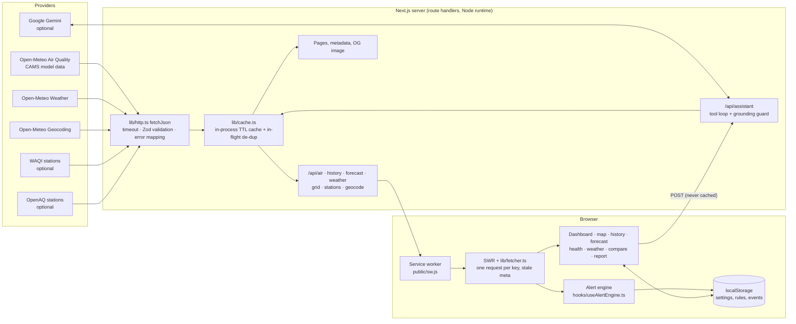

# AirIQ architecture

How data gets from the public providers to the screen, and the pieces that make decisions along the way: the AQI logic, the trend model, the alert engine, the service worker and the assistant.

## 1. Big picture

Everything the browser shows comes from AirIQ's own `/api/*` routes, except two things it fetches directly: Esri basemap tiles and BigDataCloud's reverse geocoder (only for "Use my location"). API keys stay on the server.

## 2. Server data flow

1. **Route handlers** (`app/api/*/route.ts`) validate their query with Zod (`lib/schemas.ts`, `parseQuery`). Bad input returns 400 with a readable message.
2. **Data functions** (`lib/openmeteo.ts`, `lib/waqi.ts`, `lib/openaq.ts`, `lib/stations.ts`) build the upstream URL and call `fetchJson`.
3. **`fetchJson`** (`lib/http.ts`):
   - fetches with `cache: "no-store"` and a timeout (15 s by default);
   - detects Open-Meteo's `{ error, reason }` bodies;
   - validates the response with Zod;
   - turns every failure into an `UpstreamError` with a status (502, 504, or 429 passed through).
   Nothing is ever filled in: a failed or malformed response is an error, not a guess.
4. **`cached()`** (`lib/cache.ts`) is an in-process TTL cache with in-flight de-duplication: concurrent identical requests share one upstream call. TTLs are 10 minutes for current data and the grid, 15 for forecasts, 30 for history and weather, and 24 hours for geocoding. The cache lives on `globalThis`, so pages (metadata, OG image) and route handlers share it. Next's persistent fetch cache is not used, because it served hours-old readings after idle periods.
5. **Normalisation:** times become UTC ISO strings and each series keeps its IANA time zone. Local days and hours are derived with `lib/time.ts`, never from the browser's zone or Open-Meteo's fixed-offset labels.
6. **Responses** carry `Cache-Control: public, s-maxage=…, stale-while-revalidate=…` for CDNs. Errors are `{ error, detail }` with `no-store`.
7. **Environment** (`lib/env.ts`): every key is optional and validated once (logged at startup by `instrumentation.ts`, values never logged). A missing key turns its feature off with a visible reason.

Request budget, measured on a cold server (Phase 8): the home page makes 6 Open-Meteo calls (one per city card). A city page makes 3 (geocoding for the place name, current air, 14-day history for the cigarette card). The map makes 1 batched grid call plus 1 station call. Links to city pages are not prefetched, because a prefetch renders the page on the server and spends upstream calls.

## 3. Client data layer

- **SWR keys are the URLs** built by helpers in `hooks/useCity.ts` (`airUrl`, `forecastUrl`, `historyUrl`). The same city therefore shares one request across the dashboard, the health tab, the alert engine and the report.
- **`apiFetch`** (`lib/fetcher.ts`) bypasses the browser HTTP cache. It copies the service worker's `X-AirIQ-Stale` / `X-AirIQ-Cached-At` headers into a `_meta` field on every body (`lib/stale.ts`).
- **`StaleNotice`** reads that field. Any view that shows data from the offline cache renders "Offline: showing data from HH:MM, not live", in the city's time zone, with Retry.
- **Heavy code is lazy:**
  - Recharts loads only in the Forecast, History and Weather tabs, the compare charts and the report chart.
  - Leaflet loads only on `/map`.
  - html-to-image and jsPDF load only when exporting a report.
  - The Overview tab ships no chart library.

## 4. AQI logic

- **Headline selection** (`lib/headline-source.ts`, pure, unit-tested) combines `/api/air` (model) with `/api/stations?lat&lon` (stations within 15 km, nearest first, distance and observation time; `lib/nearby.ts`). Auto: median of ≥ 3 stations observed in the last 3 h → else the nearest fresh station within 10 km → else the model. "Nearest station" and "Model only" modes come from `hooks/useDataSource.ts` (saved in storage; `?source=` overrides for a shared view). It returns `{ source, value, scale, stationCount, highest, nearest, observedAt, modelValue, reason, divergence, stationNote, stationUsAqi, naqiBasis, stationNaqi, naqiPending, consistencyWarning, olderReading }`; `source` is `"stations-median" | "station" | "model" | "unavailable"` (the last only for India NAQI). `hooks/useHeadline.ts` (`computeHeadline`) is the one place the UI, compare, report and alert engine get "the" number; the assistant calls the same `selectHeadline` on the server.
- **No conversion between scales.** WAQI gives US AQI index values only, so on the European scale the headline is the model, and NAQI uses concentrations. A failing or missing station feed returns `status: "error" | "not-configured"` and the UI shows "No nearby station data".
- **Station-based NAQI (Phase 9b).** `/api/station-naqi?lat&lon` (`lib/openaq.ts` → `lib/openaq-parse.ts` → `lib/station-naqi.ts`): OpenAQ `/locations` within 15 km → `chooseStations` (reported in the last 3 h, PM sensor, CPCB first, ≤ 15) → per station `/locations/{id}/latest` and `/sensors/{id}/hours` for PM2.5/PM10 → `naqiForStation` (PM 24 h means with the 16-hour rule, gases' latest hour, ≥ 3 pollutants incl. PM, CPCB breakpoints from `lib/naqi.ts`) → `summarizeStationNaqi` (median of ≥ 3 usable stations, else the nearest). Every OpenAQ call goes through `fetchJson` with a 10-minute cache and a shared `SlidingLimiter` (`lib/sliding-limiter.ts`: 50 requests/min, ≤ 20 s wait, 60 s back-off after HTTP 429). The route passes `req.signal`; `hooks/useHeadline.ts` (`useStationNaqi`) fetches it only on the NAQI scale and aborts a city's request when no component uses it any more (reference-counted per URL), and the server then starts no further upstream calls for it. The station US AQI route (`/api/stations`) no longer waits for OpenAQ.
- **NAQI rules in `selectHeadline`.** Station-based NAQI when available (Auto: median; Nearest station: nearest with enough data). Otherwise, if stations drive the US headline under the current mode, `source: "unavailable"` with `value: null` and the model value only in `modelValue` (UI: "India NAQI from stations unavailable" + "model estimate, likely lower than station readings here"); advice uses `adviceBasis` → the stations' US AQI. Else the model NAQI. `naqiConsistency` maps the station US AQI to a NAQI category through the PM2.5 concentration it implies (`pm25ForUsAqi`, the inverse of the EPA 2024 PM2.5 sub-index) and warns when a shown model NAQI is more than one category below it.
- **Older readings.** `olderReadingFor`: the nearest station within 10 km that reported in the last 12 h, if that reading is older than 3 h; compared with the US headline (or the model's US AQI on other scales) for the 25% note. Rendered by `components/NaqiNotes.tsx` (`OlderReadingLine`, with `NaqiBasisNote` for the NAQI labels) on the city page, compare cards and the report.
- **Model numbers** are Open-Meteo's `us_aqi` and `european_aqi`, plus AirIQ's NAQI.
- **India NAQI** (`lib/naqi.ts`): CPCB breakpoints for PM10, PM2.5, NO₂, SO₂, CO (mg/m³), O₃ and NH₃; 24-h means (8-h for CO/O₃); ≥ 16 of 24 h (6 of 8) per sub-index; ≥ 3 pollutants including PM2.5 or PM10. Computed server-side for every series point (`lib/openmeteo.ts` → `inAqi`, `inSubIndices`), for the current reading (with `inReason` when insufficient) and for each map grid cell (the grid request includes 24 h of hourly data). The forecast model's PM2.5 is converted with the same 24-h rule.
- **Beyond the index.** `indexFromTable` extends the top EPA band instead of clipping; NAQI's open-ended Severe continues the Very-poor slope. `formatIndex` shows "500+" (EU "100+"), `beyondIndexLabel` gives the computed value, the US "Beyond index" category (rank 5) keeps the Hazardous health rules, `gaugeFraction` (`lib/gauge.ts`) pins the pointer, `niceYMax` (`lib/chart-scale.ts`) extends chart axes and `rampColor` gives the heatmap a distinct colour.
- **`lib/aqi.ts`** recomputes the US AQI with the EPA May 2024 breakpoints and proper averaging windows (24 h PM, 8 h O₃ and CO, 1 h NO₂ and SO₂) as a visible cross-check. It also provides the EEA PM2.5 index and unit conversions (25 °C, 1 atm).
- **`lib/aqi-categories.ts`** is the single source of truth for categories:
  - official colours, plus a text colour checked to WCAG AA (unit-tested);
  - a pattern per category, so colour is never the only cue;
  - verdicts and health messages, WHO 2021 guideline values, and the cigarette rule.
- The main pollutant comes from Open-Meteo's per-pollutant sub-indices.

## 5. AirIQ trend model

`lib/forecast-model.ts`, served by `/api/forecast`:
- **Model:** additive Holt-Winters with a damped trend and a 24-hour season, fitted to `ln(1 + PM2.5)` over the last 28 days.
- **Parameters:** chosen by grid search on multi-step error.
- **Backtest:** the last 48 h are held out and scored against two baselines, persistence and same-hour-yesterday. The UI shows the scores and says when the model loses.
- **80% range:** from rolling-origin residuals.
- **Refusal:** the model is not shown with too little data (fewer than 216 valid hours or more than 25% missing).

Details and live backtest numbers are in the README.

## 6. Alert engine

- **Phase 9:** current-reading rules use the headline in effect on the rule's scale (`readingFor` in `hooks/useAlertEngine.ts`: station median / nearest / model under the saved data-source setting). Stations older than 3 h are ignored, so the model is used and the event's `source` says so. Values above 500 fire as "500+ (computed N)". Forecast rules are model-based and say that they may under-estimate.

- **Rules** (`lib/alerts.ts`) are stored in localStorage and validated on every read. Each rule covers:
  - a city;
  - a metric: AQI or a pollutant's sub-index, always on a stated scale;
  - a threshold, and a trigger (the current reading, or the official forecast over the next N hours);
  - optional quiet hours in the city's time zone.
- **Runtime** (`hooks/useAlertEngine.ts`, mounted once in the layout as `AlertRuntime`):
  - runs one watcher per city using the same SWR keys as the dashboard;
  - re-evaluates every 10 minutes, on tab focus and on "Check now".
- **Evaluation** (`evaluateRule`) is pure and unit-tested. Hysteresis gives one event per episode: current-reading rules re-arm below 90% of the threshold, and forecast rules re-arm when the window clears.
- **Stale data is never evaluated:** if the air or forecast data came from the offline cache, the engine skips the city and records nothing.
- **Delivery** (`lib/notify-path.ts`):
  - `ServiceWorkerRegistration.showNotification` where available, then the page `Notification`, then in-app only (bell, history, toast);
  - permission is requested only from a click;
  - quiet hours suppress only the system notification.
- **Limits:** alerts run only while an AirIQ tab is open. There is no push server.

### Map layers (Phase 9)

Stations are the primary map layer (model badges muted beneath them). `lib/heat-blend.ts` chooses the heatmap samples: **Blended** uses fresh stations where ≥ 5 are in view and model grid points only more than 15 km from any station; **Stations only**; **Model only**. Stations are blended only on the US AQI layer (they are US AQI); the legend states which source drives which part. Station popups fetch `/api/station?id=` for the dominant pollutant (WAQI index values are never shown as concentrations) and show the nearest model grid value.

## 7. Service worker

`public/sw.js` holds the event wiring. `public/sw-core.js` holds the decisions as pure, unit-tested functions. The worker is registered in production builds only, as `/sw.js?v=<build version>`.

| Request | Strategy |
| --- | --- |
| `/_next/static/*` (hashed) | Cache-first |
| Page navigations | Network-first, 6 s timeout, then the cached page (exact URL, then same path), then `/offline` |
| `GET /api/{air,history,forecast,weather,grid,stations,geocode}` | Network-first, 5 s timeout. On failure, timeout or 5xx: the last good copy, stamped `X-AirIQ-Stale: 1` and `X-AirIQ-Cached-At` |
| `/api/assistant`, any non-GET, any cross-origin request, RSC payloads | Network only, never cached |

- **Versioned caches:** on activate, every `airiq-*` cache from another version is deleted, so a deploy never keeps old assets.
- **Notification clicks:** `notificationclick` focuses an existing AirIQ window and navigates it to the alert's city, or opens a new window. Only same-origin paths are used.
- **Back online:** `ConnectivityStatus` shows "Back online. Refreshing data…" and revalidates every SWR key.

## 8. Assistant

Phase 9: `get_current_aqi`, `get_health_advice` and `compare_cities` return the headline in effect (source, reason, observation time), the station summary (count, median, highest, nearest), the model value, `stationVsModelPercent` and India NAQI (with `beyondIndex`/`display: "500+"`). `find_safe_windows` adds a `forecastNote` when stations read > 25% above the model. The system prompt says to state both station and model values when they differ, to prefer stations for "is it safe" questions, and to say plainly when a value is beyond the index. The grounding guard accepts index claims from `median`, `highest`, `nearest`, `naqi`, `headline`, `modelValue` and `display` fields, and still rejects distances and counts as AQI.

Phase 9b: the data layer gains `stationNaqi(lat, lon)`. `get_current_aqi` and `compare_cities` return `indiaNaqi` with `basis` (`"stations" | "model" | "unavailable"`) and the same label as the UI; when the basis is "unavailable" or the consistency check fails, the model value is returned only as `indiaNaqi.modelNaqiEstimate` with an instruction not to present it as the city's NAQI. `get_health_advice` on the NAQI scale uses the station US AQI when the NAQI is unavailable. `stations.olderReading` carries the 3–12 h old nearest-station reading. The grounding guard keeps each claim's sentence as context and rejects a NAQI claim backed only by `modelNaqiEstimate` (or the warning text) unless the sentence calls it a model estimate.

- **Route:** `/api/assistant` (POST) streams Server-Sent Events.
- **Model client:** `lib/assistant/gemini.ts` wraps the `@google/genai` SDK. It retries 5xx and timeouts, and applies a 45 s per-call timeout. If the main model hits its quota (429), it retries once on the backup model.
- **Tool loop** (`lib/assistant/loop.ts`):
  1. Stream the model's turn.
  2. Run any requested tools in parallel, feed the results back, and repeat, up to 6 rounds.
  3. After 6 rounds, make one last call with tools disabled.
- **Tools** (`lib/assistant/tools.ts`): `resolve_city`, `get_current_aqi`, `get_history`, `get_forecast`, `compare_cities`, `get_health_advice`, `find_safe_windows`.
  - Arguments are validated with Zod.
  - Tools call the same library functions as the routes, through the shared cache.
  - Each result carries values, units, the time zone, the source and the data time.
  - Errors come back to the model as data, never as exceptions.
- **Grounding guard** (`lib/assistant/grounding-check.ts`):
  1. Every number with a unit or AQI context in the final answer must match a number in this turn's tool results, within the rounding shown. AQI claims must match index-like fields.
  2. On a mismatch, the model gets one retry. If the answer still doesn't match, it is shown with a warning to check the data panel.
- **Safety:**
  - A deterministic check for emergency symptoms sends a fixed "seek urgent care" message first.
  - Model text is rendered as React text nodes, never as HTML.
  - Rate limit: 20 requests per 10 minutes per IP, in memory (per instance).

## 9. Security headers

Set in `next.config.ts`:
- `X-Content-Type-Options: nosniff`, `Referrer-Policy: strict-origin-when-cross-origin`, `X-Frame-Options: DENY`.
- A Permissions-Policy that allows only geolocation, for this origin.
- An enforced Content-Security-Policy:
  - `script-src 'self' 'unsafe-inline'`, with no eval;
  - images from self, `data:`, `blob:` and Esri tiles;
  - `connect-src` self plus BigDataCloud;
  - `frame-ancestors 'none'`.

The CSP was tested in the browser on every route, offline, with the service worker and with report export, and no violations were reported. `'unsafe-inline'` is needed for Next's inline RSC payload and the pre-paint theme script; nonces would force every static page to render per request.
